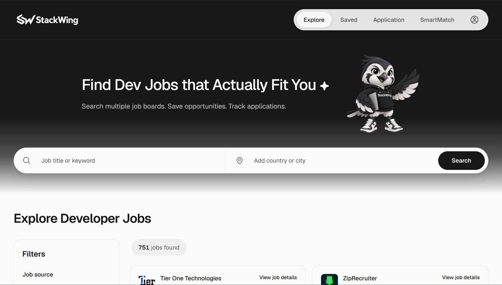
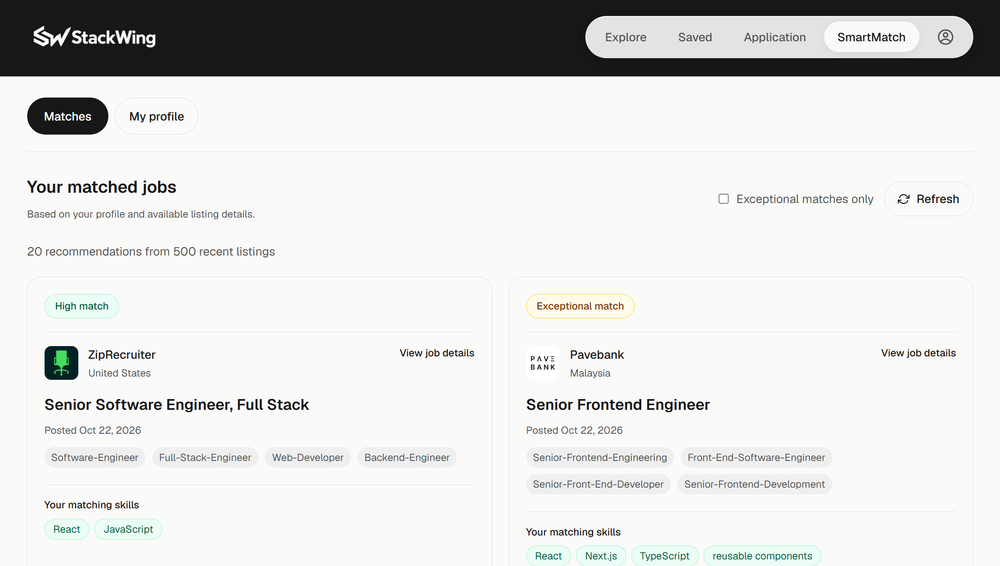
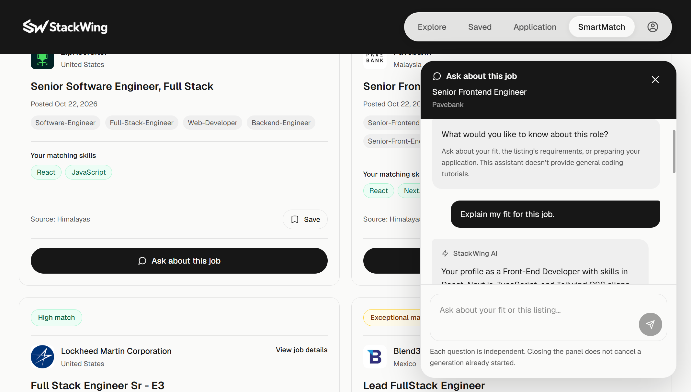
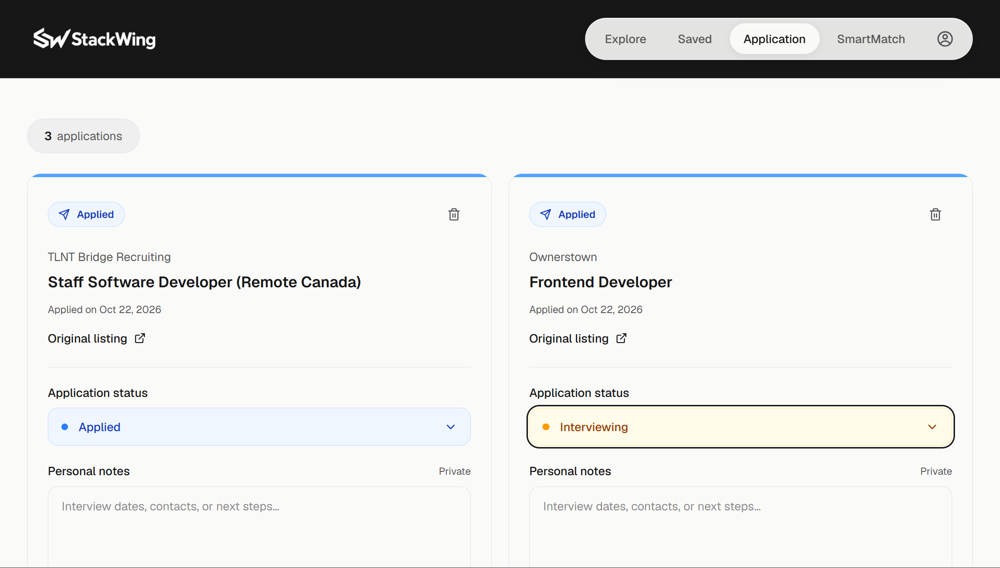

# StackWing

**Developer jobs from multiple boards, brought together in one workspace.**

[Visit StackWing](https://stackwingjobs.com) · [Privacy Policy](https://stackwingjobs.com/privacy) · [Terms of Service](https://stackwingjobs.com/terms)

## Why I built this

I started building StackWing while looking for developer jobs myself. I kept switching between LinkedIn and other job boards, searching for similar roles and setting the same filters again. I also wanted somewhere to save interesting jobs and keep track of where I had applied.

StackWing started as a way to make that process easier for me. It brings listings from selected job boards into one place, with tools to organize applications and understand how a role fits your profile.

It is an early version, and feedback is welcome.

## What it does

- **Search across job boards:** browse and filter developer jobs from Himalayas, Dev Global Jobs, We Work Remotely, and Remote OK.
- **Save jobs:** keep a shortlist of roles you want to revisit.
- **Track applications:** organize application statuses and private notes.
- **SmartMatch:** explore relevant listings based on your skills, experience, and preferences.
- **Resume-assisted profiles:** extract text from a supported resume locally, review it, and optionally use AI to draft a profile.
- **Job-specific AI chat:** ask about a role with the listing and your profile already in context, without copying the description into another tool.
- **Account and billing controls:** manage subscriptions and request account deletion.

SmartMatch uses profile-based matching against listings available within StackWing. AI assists with profile extraction and job questions; it does not search the entire internet or guarantee a job match. AI output should be reviewed.

StackWing does not import LinkedIn listings. Source coverage depends on import limits, source availability, and developer-role filtering. Some features require Pro and remain subject to usage limits.

## Screenshots

The image links below become available after the screenshots are added to `docs/images/`. Use a demo account and remove personal information, private notes, payment details, and owner-only usage panels before publishing images.

### Explore jobs



<details>
<summary>SmartMatch, AI chat, and application tracking</summary>

### SmartMatch



### Job-specific AI chat



### Application tracker



</details>

## Tech stack

| Area | Technologies |
| --- | --- |
| Frontend | Next.js, React, TypeScript, Tailwind CSS |
| Backend | Node.js, Express, TypeScript, Zod |
| Database | PostgreSQL on Neon, Drizzle ORM and migrations |
| Authentication | Clerk |
| Payments | Stripe subscriptions, customer portal, and webhooks |
| AI | OpenAI API for profile extraction and job chat |
| Testing | Vitest, Playwright, Testing Library, axe-core |
| Deployment | Docker images hosted on Render |
| Automation | GitHub Actions for CI, scheduled job refresh, and billing synchronization |

## Deployment status

The frontend and backend are currently deployed manually in Render. Optional deployment automation exists in GitHub Actions, but it must be deliberately enabled and configured. A successful CI run does not by itself mean a production deployment occurred.

See [Operations](docs/OPERATIONS.md) for release, migration, billing, and recovery procedures. Application rollbacks do not undo database migrations.

## Project structure

- `frontend/`: Next.js application.
- `backend/`: Express API, database services, import scripts, and workers.
- `backend/drizzle/`: committed database migrations.
- `.github/workflows/`: CI, job refresh, and billing synchronization.
- `docs/OPERATIONS.md`: deployment and recovery instructions.

Use Node.js 24 and npm. Run npm commands inside the relevant application folder; there is no root application package.

## Local prerequisites

You need:

- Node.js 24 and npm.
- A Neon development database.
- A separate, isolated test database for integration tests.
- Clerk development credentials for authentication and browser tests.

The backend uses the Neon HTTP driver. A plain local PostgreSQL installation is not a drop-in replacement for the current database connection.

Do not use production databases, credentials, or customer data for local testing.

## Environment setup

1. Copy `backend/.env.example` to `backend/.env`, only if that file does not already exist.
2. Copy `frontend/.env.example` to `frontend/.env`, only if that file does not already exist.
3. Replace the placeholders in your private copies.
4. Use matching Clerk development keys from the same Clerk instance in both applications.

Do not overwrite an existing working environment file. Next.js also reads `.env.local`; check that older values there do not conflict with your intended local configuration.

The Playwright configuration loads `.env` through `dotenv/config`. Keep the required browser-test credentials available there or through environment variables.

Never commit real environment files. Only placeholder `.env.example` files belong in Git.

## Install dependencies

From the project root:

```powershell
cd backend
npm ci
cd ../frontend
npm ci
```

## Apply development migrations

Before running this command, confirm that `backend/.env` points to the development database.

From `backend`:

```powershell
npm run db:migrate
```

Apply the committed migrations. Do not run `db:generate` merely to set up an existing checkout.

Database migrations can change or remove data. Production migration procedures are documented in `docs/OPERATIONS.md`.

## Start locally

In one terminal, from `backend`:

```powershell
npm run dev
```

In another terminal, from `frontend`:

```powershell
npm run dev
```

Default addresses:

- Frontend: `http://localhost:3000`
- Backend: `http://localhost:5000`
- Liveness: `http://localhost:5000/health/live`
- Readiness: `http://localhost:5000/health/ready`

Readiness checks database connectivity. Liveness does not.

An empty job list is normal for a newly created database.

## Optional development job import

This command writes listings to the configured database and contacts external job sources.

Confirm the database destination and source-use permissions first.

From `backend`:

```powershell
npm run jobs:import
```

Do not run availability or cleanup scripts just to check whether the application starts. They modify stored records.

## Backend checks

From `backend`:

```powershell
npm run format:check
npm run lint
npm run typecheck
npx tsc --project src/test/tsconfig.json --noEmit
npx vitest run --exclude "src/test/integration/**" --maxWorkers=2
npm run build
```

The command above excludes external-database integration tests.

### Database integration tests

Set `TEST_DATABASE_URL` to a separate, disposable test database.

These tests write and delete records. Some tests invoke cleanup against the configured database. Never point them at production or a database containing valuable data.

Different passwords, users, or connection-string spellings do not prove that two URLs point to different databases. Verify the actual destination.

From `backend`:

```powershell
npm run db:migrate:test
npm run test:integration
```

Do not run locally while GitHub Actions is using the same test database. Prefer a separate local test database.

## Frontend checks

From `frontend`:

```powershell
npm run format:check
npm run lint
npm run test:run
npm run build
```

### Browser and accessibility tests

Configure matching Clerk development keys and a dedicated development test user:

```text
E2E_CLERK_USER_EMAIL=stackwing-e2e+clerk_test@example.com
```

Create that user in the same Clerk development instance. The current sign-in helper uses the test user's email; it does not read a password variable.

From `frontend`:

```powershell
npx playwright install chromium
npx playwright test --project=chromium
```

Playwright starts:

- A mock API on port `5010`.
- A Next.js test server on port `3100`.

Keep those ports available. The tests use mocked application APIs, but Clerk setup and sign-in still require network access.

Do not replace production Clerk credentials in Render to fix browser tests. Local tests and CI use development credentials.

Playwright reports and traces may contain authentication or personal information. Do not commit or publicly share them.

## Feature configuration

Local examples disable AI calls, live billing, and account deletion by default.

- SmartMatch AI requires its enable flag, provider credentials, and applicable access checks.
- Billing requires matching Stripe mode, credentials, price, and portal configuration.
- Account deletion requires coordinated backend, worker, and frontend settings.

Do not copy local defaults over existing production configuration.

See `docs/OPERATIONS.md` for deployment, environment separation, billing, and recovery.

## Current operational limits

- Job imports run daily; availability checks run hourly.
- Availability checks process up to 200 active and 20 inactive jobs per run.
- Active jobs become eligible after 24 hours; inactive jobs after seven days.
- Himalayas imports are capped at 20 pages of up to 20 listings.
- Dev Global Jobs imports are capped at 10 pages of up to 100 listings.
- Developer-role filtering reduces the number actually imported.
- Import caps and availability budgets do not guarantee complete source coverage.
- GitHub scheduled runs may be delayed.
- Some rate limits and concurrency controls remain process-local.
- HTTP request logging is structured; scheduled scripts and worker logs are not yet fully standardized.
- CI deployment requests do not automatically verify subsequent application health.

Respect each job source's current attribution, licensing, and commercial-use requirements.


